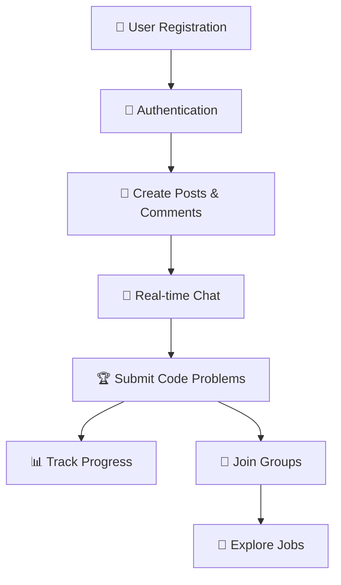

# 🚀 IT Social Platform - Comprehensive Architecture & Documentation

> **A Modern Microservices-based Social Learning & Code Execution Platform**

<div align="center">


**Status**: 🟢 Active Development | **Latest Update**: May 2026

</div>

---

## 📖 Table of Contents

1. [🎯 Project Overview](#-project-overview)
2. [🏗️ System Architecture](#️-system-architecture)
3. [🛠️ Technology Stack](#️-technology-stack)
4. [📦 Service Components](#-service-components)
5. [📂 File Structure](#-file-structure)
6. [✨ Key Features](#-key-features)
7. [📚 Knowledge Areas](#-knowledge-areas)
8. [🎓 Applied Technologies & Patterns](#-applied-technologies--patterns)
9. [⚙️ DevOps & Infrastructure](#️-devops--infrastructure)
10. [❓ Key Questions & Answers](#-key-questions--answers)
11. [🚀 Getting Started](#-getting-started)
12. [🔗 Service Communication](#-service-communication)
13. [🧪 Testing & Quality](#-testing--quality)
14. [📝 Contributing](#-contributing)

---

## 🎯 Project Overview

### 📌 What is IT Social Platform?

**IT Social Platform** is a comprehensive, production-grade microservices application that combines:

| 🎓 | 💻 | 🤝 | 💼 |
|:-:|:-:|:-:|:-:|
| **Social Learning** | **Code Execution** | **Real-time Chat** | **Job Platform** |
| User profiles & relationships | Judge0-based code judging | WebSocket messaging | Job aggregation |
| Posts & comments | Multiple language support | Presence tracking | Career opportunities |
| Community groups | Submission history | Group messaging | Application management |

### 🎬 Core Use Cases



### 📊 Platform Metrics

- **Real-time Capabilities**: Chat, Notifications, Presence Tracking
- **Supported Languages**: Java, C++, Python, JavaScript, C#, Go, Rust, Ruby
- **External Integrations**: Google OAuth, OpenAI, Google Gemini AI, RSS Feeds
- **File Storage**: Cloudinary (images, documents)
- **Message Broker**: RabbitMQ (async communication)

---

## 🏗️ System Architecture

### 🔄 High-Level Architecture Diagram

```
┌─────────────────────────────────────────────────────────────────────┐
│                   🎨 Frontend & Admin Interfaces                    │
│                  React 19 + Vite + Tailwind CSS                     │
│           (localhost:3000 / localhost:5173 dev mode)                │
└────────────────────────────────┬────────────────────────────────────┘
                                 │
                        📡 localhost:8080
                                 │
                 ┌────────────────▼────────────────┐
                 │   🚪 API Gateway (Express)      │
                 │  Request Routing & Security     │
                 │  Rate Limiting • JWT Auth       │
                 │  Correlation ID Tracking        │
                 └────────────────┬────────────────┘
                                 │
        ┌────────────────────────┼────────────────────────┐
        │                        │                        │
   ┌────▼────┐        ┌──────────▼──────────┐    ┌──────▼───────┐
   │🔑 Auth  │        │👥 User Service      │    │📄 Content    │
   │Service  │        │(.NET Core 8)        │    │Service       │
   │.NET 8   │        │  • Profiles         │    │(Node.js)     │
   │:8001    │        │  • Relationships    │    │  • Posts     │
   └────┬────┘        │  • Search           │    │  • Comments  │
        │             │  • Admin            │    │  • Groups    │
        │             └─────────┬────────────┘    │  • Jobs      │
        │                       │                 │  • AI        │
        │             ┌─────────▼────────┐        └──────┬───────┘
        │             │💬 Chat Service   │               │
        │             │(Node.js)         │               │
        │             │ • Group Chats    │               │
        │             │ • Direct Messages│               │
        │             │ • Presence       │               │
        │             │ • Socket.IO      │               │
        │             └─────────┬────────┘               │
        │                       │                        │
   ┌────▼────┐        ┌─────────┼────────┐    ┌────────▼───────┐
   │💻 Code  │        │🔔 Notifications   │    │🌐 RabbitMQ     │
   │Judge    │        │(Node.js)          │    │Message Broker  │
   │.NET     │        │ • WebSocket       │    │  • Events      │
   │:8004    │        │ • Email           │    │  • Async Msgs  │
   └────┬────┘        │ • Job Scheduler   │    │  • Queues      │
        │             └─────────┬────────┘    └────────┬───────┘
        │                       │                      │
        └───────────────┬───────┴──────────────────────┘
                        │
            ┌───────────▼──────────┐
            │  💾 MongoDB          │
            │  Data Persistence    │
            │  • Collections       │
            │  • Indexes           │
            └──────────────────────┘
```

### 🔐 Authentication & Authorization Flow

```
1. 📝 User Login
   └─→ Frontend sends credentials → API Gateway
2. 🔑 Token Generation
   └─→ API Gateway → Auth Service
3. ✅ Token Validation
   └─→ Auth Service validates & returns JWT
4. 📡 Subsequent Requests
   └─→ JWT in Authorization header
5. 🛡️ Service Authorization
   └─→ Each service validates token & permissions
```

### 📡 Request Context Headers

```http
Authorization: Bearer <jwt-token>
x-correlation-id: <unique-trace-id>
x-user-id: <user-identifier>
x-user-roles: <permission-roles>
x-forwarded-for: <original-client-ip>
Content-Type: application/json
```

---

## 🛠️ Technology Stack

### 🎨 Frontend Layer

| Component | Technology | Version | Purpose |
|-----------|-----------|---------|---------|
| **Framework** | React | 19.2.0 | UI library |
| **Build Tool** | Vite | 5.x | Fast bundling |
| **Styling** | Tailwind CSS | 3.4.1 | Utility-first CSS |
| **State Mgmt** | Redux Toolkit | 2.11.2 | Global state |
| **Server State** | React Query | 5.95.2 | API caching |
| **Routing** | React Router | 7.11.0 | Client routing |
| **HTTP Client** | Axios | 1.13.2 | REST requests |
| **Real-time** | Socket.IO Client | 4.8.3 | WebSocket |
| **Code Editor** | Monaco Editor | 4.7.0 | Code input |
| **Markdown** | react-markdown | 10.1.0 | Rich content |
| **Animations** | Framer Motion | 12.31.1 | UI animations |
| **Icons** | Lucide React | 0.563.0 | Icon library |
| **Notifications** | React Toastify | 11.0.5 | Toast messages |

### 🔙 Backend - API Gateway

| Component | Technology | Version | Purpose |
|-----------|-----------|---------|---------|
| **Runtime** | Node.js | 20-Alpine | JavaScript runtime |
| **Framework** | Express.js | 4.19.2 | Web framework |
| **Security** | Helmet | 7.1.0 | HTTP headers |
| **Authentication** | jsonwebtoken | 9.0.2 | JWT handling |
| **Rate Limiting** | express-rate-limit | 7.4.0 | Request throttling |
| **File Upload** | multer | 2.1.1 | Multipart forms |
| **HTTP Client** | Axios | 1.7.7 | Service calls |
| **Logging** | Morgan | 1.10.0 | HTTP logs |
| **Environment** | dotenv | 16.4.5 | Config management |

### 🔐 Auth Service (.NET Core 8)

| Component | Purpose |
|-----------|---------|
| **Framework** | ASP.NET Core 8 |
| **ORM** | Entity Framework Core |
| **Authentication** | JWT + Google OAuth |
| **Architecture** | Domain-Driven Design |
| **Database** | SQL Server / PostgreSQL |

### 👥 User Service (.NET Core 8)

| Component | Purpose |
|-----------|---------|
| **Framework** | ASP.NET Core 8 |
| **ORM** | Entity Framework Core |
| **Architecture** | Domain-Driven Design (DDD) |
| **Features** | Profile management, relationships, search |

### 📄 Content Service (Node.js)

| Component | Technology | Purpose |
|-----------|-----------|---------|
| **Framework** | Express | Web server |
| **Database** | Mongoose | MongoDB ODM |
| **File Storage** | Cloudinary | Image/media hosting |
| **AI Integration** | OpenAI SDK | GPT models |
| **AI Integration** | @google/generative-ai | Gemini API |
| **Message Queue** | amqplib | RabbitMQ client |
| **Features** | Posts, comments, groups, jobs, AI |

### 💬 Chat Service (Node.js)

| Component | Technology | Purpose |
|-----------|-----------|---------|
| **Framework** | Express | Web server |
| **Real-time** | Socket.IO | WebSocket protocol |
| **Database** | Mongoose | MongoDB ODM |
| **Message Queue** | amqplib | RabbitMQ client |
| **Features** | Group chats, messaging, presence |

### 💻 Code Judge Service (.NET Core 8)

| Component | Purpose |
|-----------|---------|
| **Framework** | ASP.NET Core 8 |
| **Code Execution** | Judge0 API integration |
| **Languages** | Java, C++, Python, JS, C#, Go, Rust, Ruby |
| **Features** | Problem management, submissions, leaderboards |

### 🔔 Notification Service (Node.js)

| Component | Technology | Purpose |
|-----------|-----------|---------|
| **Framework** | Express | Web server |
| **Real-time** | Socket.IO | WebSocket notifications |
| **Email** | Nodemailer | SMTP integration |
| **Database** | Mongoose | MongoDB persistence |
| **Message Queue** | amqplib | RabbitMQ consumer |
| **Features** | Real-time alerts, email, retries |

### 🏢 Infrastructure & DevOps

| Component | Technology | Purpose |
|-----------|-----------|---------|
| **Containerization** | Docker | Container images |
| **Orchestration** | Docker Compose | Local development |
| **Message Broker** | RabbitMQ | Async messaging |
| **Database** | MongoDB | NoSQL data store |
| **Storage** | Cloudinary | CDN + file hosting |
| **Development** | VS Code | IDE |
| **Version Control** | Git | Source management |

---

## 📦 Service Components

### 1️⃣ API Gateway (Port 8080)

#### 📍 Location
```
api-gateway/
├── src/
│   ├── app.js                 # Express app setup
│   ├── server.js              # Entry point
│   ├── clients/               # Service clients
│   │   ├── auth.client.js
│   │   ├── user.client.js
│   │   ├── content.client.js
│   │   ├── chat.client.js
│   │   ├── codejudge.client.js
│   │   ├── notification.client.js
│   │   ├── ai.client.js
│   │   ├── judge0.client.js
│   │   └── external.client.js
│   ├── config/
│   │   ├── constants.js       # App constants
│   │   └── env.js             # Environment config
│   ├── controllers/           # Request handlers
│   │   ├── admin.controller.js
│   │   ├── ai.controller.js
│   │   ├── auth.controller.js
│   │   ├── chat.controller.js
│   │   ├── code.controller.js
│   │   └── ... (more controllers)
│   ├── middlewares/           # Custom middleware
│   ├── routes/                # API routes
│   └── utils/                 # Utilities
├── Dockerfile
└── package.json
```

#### 🎯 Responsibilities
- ✅ Route API requests to appropriate microservices
- ✅ Rate limiting (300 req/60sec)
- ✅ JWT authentication & validation
- ✅ Request correlation tracking
- ✅ Security headers (Helmet)
- ✅ CORS configuration
- ✅ File upload handling
- ✅ Request/response logging

#### 📡 API Routes

```javascript
GET/POST  /api/auth/*              // Authentication
GET/POST  /api/users/*             // User profiles
GET/POST  /api/code/*              // Code problems & submissions
GET/POST  /api/content/*           // Posts, comments, groups, jobs
GET/POST  /api/chats/*             // Chat messages
GET/POST  /api/notifications/*     // Notifications
POST      /api/uploads/*           // File uploads
GET       /api/external/*          // External APIs
POST      /api/ai/*                // AI services
GET/POST  /api/admin/*             // Admin operations
```

---

### 2️⃣ Frontend Application (Port 3000)

#### 📍 Location
```
frontend/
├── public/                    # Static assets
│   └── sounds/               # Audio files
├── src/
│   ├── main.jsx              # Entry point
│   ├── App.jsx               # Root component
│   ├── App.css               # Global styles
│   ├── index.css             # Tailwind CSS
│   ├── app/                  # App layout
│   ├── routes/               # Route definitions
│   ├── features/             # Feature modules
│   │   ├── auth/             # Authentication UI
│   │   ├── chat/             # Chat interface
│   │   ├── code/             # Code editor & judge
│   │   ├── content/          # Posts & comments
│   │   ├── user/             # User profiles
│   │   ├── jobs/             # Job listings
│   │   └── admin/            # Admin panel
│   ├── components/           # Reusable components
│   │   ├── Button.jsx
│   │   ├── Header.jsx
│   │   ├── Navigation.jsx
│   │   └── ... (more components)
│   ├── services/             # API services
│   │   ├── http.js           # Axios config
│   │   ├── interceptors.js   # Request/response hooks
│   │   ├── tokenStorage.js   # JWT management
│   │   └── api/              # API endpoints
│   ├── shared/               # Utilities & constants
│   ├── context/              # React contexts
│   ├── assets/               # Images, icons
│   └── architecture/         # System monitoring
├── index.html                # HTML template
├── vite.config.js            # Vite config
├── tailwind.config.js        # Tailwind config
├── postcss.config.js         # PostCSS config
├── package.json
└── Dockerfile
```

#### 🎯 Key Features
- 🔐 User authentication (JWT + Google OAuth)
- 👤 User profiles & relationships
- 📝 Create, edit, delete posts
- 💬 Real-time chat & messaging
- 🏆 Code editor & problem solving
- 📊 Progress tracking & leaderboards
- 👥 Community groups
- 💼 Job listings & applications
- 🎨 Responsive design with Tailwind
- 🌓 Smooth animations with Framer Motion

#### 📡 State Management Pattern

```javascript
// Global State (Redux)
store.user              // Current user info
store.auth              // Auth tokens & status
store.ui               // UI state

// Server State (React Query)
queries.posts          // Posts list
queries.chatMessages   // Chat history
queries.userProfile    // User info

// Real-time State (Socket.IO)
socket.messages        // Live messages
socket.presence        // User online status
socket.notifications   // Real-time alerts
```

---

### 3️⃣ Auth Service (Port 8001)

#### 📍 Architecture Pattern: DDD (Domain-Driven Design)

```
services/auth-service/
├── Auth.API/                 # Presentation layer
│   ├── Controllers/
│   ├── Filters/
│   ├── Middlewares/
│   ├── Program.cs
│   └── appsettings.json
├── Auth.Application/         # Business logic layer
├── Auth.Domain/              # Core domain logic
├── Auth.Infrastructure/      # Data access layer
├── database/                 # Database scripts
├── Dockerfile
└── AuthService.sln
```

#### 🎯 Responsibilities
- ✅ User registration & login
- ✅ JWT token generation & validation
- ✅ Google OAuth integration
- ✅ Password management & reset
- ✅ Token refresh & expiration
- ✅ Account locking (admin)
- ✅ Session management

#### 🔐 Authentication Flow

```
1. User Credentials → API Gateway
2. API Gateway → Auth Service
3. Validate credentials
4. Generate JWT token
5. Return token to frontend
6. Frontend stores token (localStorage)
7. Attach token to requests
8. Services validate token
```

---

### 4️⃣ User Service (Port 8002)

#### 📍 Architecture: Domain-Driven Design

```
services/user-service/
├── User.API/                 # Controllers & endpoints
├── User.Application/         # Use cases & logic
├── User.Domain/              # Business entities
├── User.Infrastructure/      # Data persistence
├── database/                 # Migrations
├── src/
└── User.sln
```

#### 🎯 Responsibilities
- ✅ User profile management
- ✅ Profile information (bio, avatar, skills)
- ✅ Follow/follower relationships
- ✅ User search & discovery
- ✅ Admin user management
- ✅ User statistics & analytics

#### 👥 User Profile Structure

```json
{
  "id": "uuid",
  "username": "string",
  "email": "string",
  "avatar": "url",
  "bio": "string",
  "skills": ["string"],
  "location": "string",
  "socialLinks": {
    "github": "url",
    "linkedin": "url"
  },
  "followers": ["userId"],
  "following": ["userId"],
  "createdAt": "datetime",
  "updatedAt": "datetime"
}
```

---

### 5️⃣ Content Service (Port 8003)

#### 📍 Location & Structure

```
services/content-service/
├── src/
│   ├── app.js                # Express setup
│   ├── server.js             # Entry point
│   ├── modules/
│   │   ├── post/             # Post CRUD
│   │   │   ├── post.model.js
│   │   │   ├── post.controller.js
│   │   │   ├── post.route.js
│   │   │   └── post.service.js
│   │   ├── comment/          # Comments
│   │   ├── group/            # Community groups
│   │   ├── job/              # Job listings
│   │   ├── upload/           # File uploads
│   │   ├── ai/               # AI features
│   │   └── admin/            # Admin ops
│   ├── integrations/
│   │   ├── cloudinary/       # Image storage
│   │   └── ai.service.js     # AI APIs
│   ├── events/               # RabbitMQ events
│   ├── storage/              # Data layer
│   └── config/
│       ├── db.js             # MongoDB
│       └── env.js
├── posts.json                # Sample data
├── comments.json
├── groups.json
├── jobs.json
├── docker-compose.yml
├── Dockerfile
└── package.json
```

#### 🎯 Features & Responsibilities

##### 📝 Posts Module
- Create, read, update, delete posts
- Post media (images, videos)
- Post metadata (likes, shares, views)
- Rich text editing

##### 💬 Comments Module
- Nested comment threads
- Comment replies
- Comment moderation
- Comment deletion

##### 👥 Groups Module
- Create & manage groups
- Group membership
- Group invitations
- Group-based discussions

##### 💼 Jobs Module
- Job listings aggregation
- RSS feed integration:
  - VietnamWorks
  - CareerBuilder
  - TopCV
- Job filtering & search
- Application management

##### 🖼️ Upload Module
- Cloudinary integration
- Image optimization
- File storage & CDN
- Image transformation

##### 🤖 AI Module
- OpenAI integration (GPT models)
- Google Gemini AI
- AI-powered content suggestions
- Text generation & enhancement

---

### 6️⃣ Chat Service (Port 5004)

#### 📍 Location & Structure

```
services/chat-service/
├── src/
│   ├── app.js
│   ├── server.js             # Entry point
│   ├── modules/
│   │   ├── chat/             # Chat groups
│   │   │   ├── chat.model.js
│   │   │   ├── chat.controller.js
│   │   │   └── chat.service.js
│   │   ├── message/          # Messages
│   │   └── presence/         # User online status
│   ├── socket/               # Socket.IO setup
│   │   ├── adapter.js
│   │   ├── handlers/
│   │   └── events.js
│   ├── messaging/            # RabbitMQ pub
│   ├── events/               # Event handlers
│   ├── config/
│   │   ├── db.js
│   │   └── rabbitmq.js
│   └── middleware/
├── chatcounters.json         # Sample data
├── messages.json
├── docker-compose.yml
├── Dockerfile
└── package.json
```

#### 🎯 Real-time Features

##### 💬 Messaging
- Group conversations
- Direct messages
- Message history (MongoDB)
- Message search

##### 👁️ Presence Tracking
- User online/offline status
- Real-time presence updates
- Typing indicators
- Last seen timestamp

##### 🔔 Event Publishing
- Message sent events
- User online events
- User offline events
- Call invitation events

#### 📡 Socket.IO Events

```javascript
// Client → Server
socket.emit('message.send', { content, chatId })
socket.emit('presence.update', { status })
socket.emit('typing.start', { chatId })
socket.emit('typing.stop', { chatId })

// Server → Client
socket.on('message.received', (message) => {})
socket.on('presence.changed', (user) => {})
socket.on('typing.indicator', (user) => {})
socket.on('notification', (notify) => {})
```

---

### 7️⃣ Code Judge Service (Port 8004)

#### 📍 Architecture: DDD

```
services/code-judge-service/
├── CodeJudge.API/            # Controllers
├── CodeJudge.Application/    # Business logic
├── CodeJudge.Domain/         # Domain entities
├── CodeJudge.Infrastructure/ # Data access
├── CodeJudge.Runner.Node/    # Execution runtime
├── database/                 # Schemas
├── src/
├── Dockerfile
├── docker-compose.yml
└── CodeJudgeService.sln
```

#### 🎯 Responsibilities
- ✅ Code problem management
- ✅ Code submission processing
- ✅ Judge0 API integration
- ✅ Multi-language support
- ✅ Test case evaluation
- ✅ Execution time tracking
- ✅ Memory usage monitoring
- ✅ Leaderboard & rankings

#### 💻 Supported Languages

| Language | Version | Features |
|----------|---------|----------|
| Java | 8+ | Full support |
| C++ | 11+ | Full support |
| Python | 3.x | Full support |
| JavaScript | ES6+ | Full support |
| C# | .NET Core | Full support |
| Go | 1.x | Full support |
| Rust | Latest | Full support |
| Ruby | 2.7+ | Full support |

#### 🔄 Submission Flow

```
1. User writes code
2. Submit via frontend
3. API Gateway → Code Judge Service
4. Create submission record
5. Call Judge0 API
6. Poll for results
7. Store results in DB
8. Return to frontend
9. Update leaderboard
10. Send notification
```

---

### 8️⃣ Notification Service (Port 5010)

#### 📍 Location & Structure

```
services/notification-service/
├── src/
│   ├── app.js
│   ├── server.js             # Entry point
│   ├── modules/
│   │   └── notification/
│   │       ├── notification.model.js
│   │       ├── notification.controller.js
│   │       └── notification.service.js
│   ├── jobs/                 # Scheduled tasks
│   │   ├── retry-failed-deliveries.job
│   │   └── cleanup-old-notifications.job
│   ├── events/               # Event registry
│   ├── integrations/
│   │   ├── broker/           # RabbitMQ
│   │   └── websocket/        # Socket.IO
│   ├── config/
│   │   ├── database.js
│   │   └── env.js
│   └── middleware/
├── docker-compose.yml
├── Dockerfile
└── package.json
```

#### 🎯 Notification Types

##### 🔔 Real-time (WebSocket)
- Message received
- Comment notification
- Post liked
- User followed
- Group invitation
- Typing indicators

##### 📧 Email Notifications
- Account created
- Password reset
- Important updates
- Weekly digest
- Job recommendations

##### 🔄 Retry Mechanism
- Failed delivery tracking
- Exponential backoff
- Max retry attempts
- Dead letter queue

#### 📡 Event Flow

```
Service A → RabbitMQ Exchange → Notification Service
                                 ↓
                          Check notification type
                                 ↓
                        ┌─────────┴─────────┐
                        ↓                   ↓
                   Real-time          Email
                   (WebSocket)        (SMTP)
                        ↓                   ↓
                   Connected?         Store & Queue
                        ↓                   ↓
                   Send via            Nodemailer
                   Socket.IO           Delivery
```

---

## 📂 File Structure

### 📁 Project Root Organization

```
it-social-platform/
│
├── 📄 docker-compose.yml       # Main compose file
├── 📄 Dockerfile               # Main app Dockerfile
├── 📄 package.json             # Root package config
│
├── 📁 api-gateway/             # API Gateway service
│   ├── src/
│   ├── Dockerfile
│   └── package.json
│
├── 📁 frontend/                # React frontend
│   ├── src/
│   ├── public/
│   ├── Dockerfile
│   ├── vite.config.js
│   ├── tailwind.config.js
│   └── package.json
│
├── 📁 frontend-admin/          # Admin panel
│   ├── src/
│   ├── public/
│   ├── vite.config.js
│   └── package.json
│
├── 📁 services/                # Microservices
│   ├── 📁 auth-service/        # .NET Core
│   ├── 📁 user-service/        # .NET Core
│   ├── 📁 content-service/     # Node.js
│   ├── 📁 chat-service/        # Node.js
│   ├── 📁 code-judge-service/  # .NET Core
│   ├── 📁 notification-service/# Node.js
│   └── 📄 docker-compose.yml   # Services compose
│
├── 📁 docs/                    # Documentation
│   ├── generate_*.py           # Doc generators
│   └── ...
│
└── 📄 SQL Scripts/             # Database setup
    ├── complete_lesson1_unlock_lesson2.sql
    ├── setup_auto_unlock.sql
    ├── SQLQuery_DB.sql
    ├── SQLQuery_DL.sql
    └── unlock_path001.sql
```

### 🗂️ Detailed Frontend Structure

```
frontend/src/
├── 📄 main.jsx                 # Vite entry
├── 📄 App.jsx                  # Root component
├── 📄 App.css                  # Global styles
├── 📄 index.css                # Tailwind base
│
├── 📁 app/                     # App layout
│   ├── AppLayout.jsx
│   ├── Header.jsx
│   └── Navigation.jsx
│
├── 📁 routes/                  # Route definitions
│   ├── routes.jsx
│   └── ProtectedRoute.jsx
│
├── 📁 features/                # Feature modules
│   ├── auth/
│   │   ├── components/
│   │   ├── pages/
│   │   ├── services/
│   │   └── store/
│   ├── user/
│   ├── content/
│   ├── chat/
│   ├── code/
│   ├── jobs/
│   ├── admin/
│   └── notifications/
│
├── 📁 components/              # Reusable components
│   ├── Button/
│   ├── Modal/
│   ├── Form/
│   ├── Card/
│   ├── Loading/
│   └── ...
│
├── 📁 services/                # API services
│   ├── http.js                 # Axios instance
│   ├── interceptors.js         # HTTP interceptors
│   ├── tokenStorage.js         # JWT storage
│   └── api/
│       ├── authAPI.js
│       ├── userAPI.js
│       ├── contentAPI.js
│       ├── chatAPI.js
│       ├── codeAPI.js
│       └── ...
│
├── 📁 context/                 # React contexts
│   ├── AuthContext.jsx
│   ├── UserContext.jsx
│   └── ...
│
├── 📁 shared/                  # Shared utilities
│   ├── constants.js
│   ├── helpers.js
│   ├── hooks/
│   └── utils/
│
├── 📁 assets/                  # Static assets
│   ├── images/
│   ├── icons/
│   └── sounds/
│
└── 📁 architecture/            # System monitoring
    └── components/
```

### 🗂️ Detailed Backend Gateway Structure

```
api-gateway/src/
├── 📄 app.js                   # Express setup
├── 📄 server.js                # Server entry
│
├── 📁 clients/                 # Service clients
│   ├── auth.client.js
│   ├── user.client.js
│   ├── content.client.js
│   ├── chat.client.js
│   ├── codejudge.client.js
│   ├── notification.client.js
│   ├── ai.client.js
│   ├── judge0.client.js
│   └── external.client.js
│
├── 📁 config/                  # Configuration
│   ├── constants.js
│   ├── env.js
│   └── logger.js
│
├── 📁 controllers/             # Request handlers
│   ├── admin.controller.js
│   ├── ai.controller.js
│   ├── auth.controller.js
│   ├── chat.controller.js
│   ├── code.controller.js
│   ├── content.controller.js
│   ├── external.controller.js
│   ├── judge0.controller.js
│   ├── notification.controller.js
│   ├── upload.controller.js
│   └── user.controller.js
│
├── 📁 middlewares/             # Custom middleware
│   ├── auth.middleware.js
│   ├── errorHandler.middleware.js
│   ├── validation.middleware.js
│   ├── corsConfig.middleware.js
│   └── logging.middleware.js
│
├── 📁 routes/                  # API routes
│   ├── admin.routes.js
│   ├── ai.routes.js
│   ├── auth.routes.js
│   ├── chat.routes.js
│   ├── code.routes.js
│   ├── content.routes.js
│   ├── external.routes.js
│   ├── upload.routes.js
│   └── user.routes.js
│
└── 📁 utils/                   # Utility functions
    ├── validators.js
    ├── errors.js
    ├── formatters.js
    └── helpers.js
```

---

## ✨ Key Features

### 🔐 Authentication & Authorization
- ✅ JWT-based authentication
- ✅ Google OAuth 2.0 integration
- ✅ Password hashing & validation
- ✅ Token refresh mechanism
- ✅ Role-based access control (RBAC)
- ✅ Admin account management

### 👤 User Management
- ✅ Complete user profiles
- ✅ Follow/follower system
- ✅ User skills & expertise
- ✅ User search & discovery
- ✅ Social links integration
- ✅ Profile customization

### 📝 Content Management
- ✅ Create, read, update, delete posts
- ✅ Media uploads (images, documents)
- ✅ Rich text editing
- ✅ Comment threads (nested)
- ✅ Like & share functionality
- ✅ Search & filtering
- ✅ Trending content

### 👥 Community Features
- ✅ Create & join groups
- ✅ Group membership management
- ✅ Group-based discussions
- ✅ Group invitations
- ✅ Group roles & permissions

### 💬 Real-time Chat
- ✅ Direct messaging
- ✅ Group chats
- ✅ Message persistence
- ✅ Message search
- ✅ User presence tracking
- ✅ Typing indicators
- ✅ Read receipts

### 💻 Code Judging Platform
- ✅ Multiple programming languages
- ✅ Code editor (Monaco)
- ✅ Real-time code execution
- ✅ Automated test case evaluation
- ✅ Performance metrics (time, memory)
- ✅ Submission history
- ✅ Leaderboards & rankings

### 📊 Job Platform
- ✅ Job aggregation (RSS feeds)
- ✅ Job filtering & search
- ✅ Job applications
- ✅ Application tracking
- ✅ Job recommendations

### 🤖 AI Integration
- ✅ OpenAI GPT models
- ✅ Google Gemini AI
- ✅ AI-powered content suggestions
- ✅ Automated text generation
- ✅ Smart recommendations

### 🔔 Notifications
- ✅ Real-time WebSocket notifications
- ✅ Email notifications
- ✅ Notification preferences
- ✅ Delivery retry mechanism
- ✅ Notification history

### 📁 File Management
- ✅ Cloudinary integration
- ✅ Image optimization
- ✅ CDN distribution
- ✅ File transformation
- ✅ Multi-format support

---

## 📚 Knowledge Areas

### 🎓 Core Concepts to Master

#### 1. **Microservices Architecture**
- Service decomposition principles
- Service boundaries & responsibilities
- Database per service pattern
- API versioning & contracts
- Service discovery
- Distributed transactions

#### 2. **Asynchronous Communication**
- Message queues (RabbitMQ)
- Publish-Subscribe pattern
- Event-driven architecture
- Dead letter queues
- Message reliability
- Idempotency

#### 3. **Real-time Communication**
- WebSocket protocol
- Socket.IO library
- Room & namespace management
- Broadcasting & targeted messaging
- Connection lifecycle
- Reconnection strategies

#### 4. **API Gateway Pattern**
- Request routing
- Rate limiting & throttling
- Authentication & authorization
- Request/response transformation
- Logging & correlation
- Circuit breaking

#### 5. **Database Design**
- MongoDB schema design
- Indexes & optimization
- Query performance
- Data aggregation
- Transactions (if applicable)
- Backup & recovery

#### 6. **Authentication & Security**
- JWT tokens & claims
- OAuth 2.0 flow
- Password hashing (bcrypt)
- CORS policy
- HTTPS/TLS
- SQL injection prevention
- XSS protection

#### 7. **Frontend Architecture**
- Component-based design
- State management patterns
- Server state vs. client state
- Custom hooks
- Performance optimization
- Code splitting

#### 8. **DevOps & Deployment**
- Docker containerization
- Docker Compose orchestration
- Environment configuration
- CI/CD pipelines
- Logging & monitoring
- Health checks

---

## 🎓 Applied Technologies & Patterns

### 🏗️ Architectural Patterns

#### **Microservices Pattern**
- Independent deployable services
- Service mesh (future enhancement)
- API Gateway as entry point
- Eventual consistency

#### **Event-Driven Architecture**
- RabbitMQ for async messaging
- Event sourcing (optional)
- CQRS pattern (optional)
- Saga pattern for distributed transactions

#### **API Gateway Pattern**
- Single entry point
- Service routing
- Cross-cutting concerns (auth, logging)
- Rate limiting

#### **Domain-Driven Design (DDD)**
- Used in .NET services
- Bounded contexts
- Ubiquitous language
- Value objects & entities

---

### 🔐 Security Patterns

#### **JWT Authentication**
```
User → Credentials → Auth Service → JWT Token → Stored in Frontend
Frontend → JWT in header → API Gateway → Service validation
```

#### **CORS (Cross-Origin Resource Sharing)**
```
Frontend → preflight request (OPTIONS)
Backend → CORS headers in response
Browser → allow request if valid
```

#### **Rate Limiting**
```
Request → API Gateway → Check rate limit
Within limit → forward to service
Exceeds limit → return 429 Too Many Requests
```

---

### 💾 Data Patterns

#### **Database Per Service**
```
Auth Service → Own DB (SQL Server)
User Service → Own DB (SQL Server)
Content Service → MongoDB
Chat Service → MongoDB
Code Judge → Own DB (SQL Server)
Notification → MongoDB
```

#### **Polyglot Persistence**
- SQL (Auth, User, Code Judge) → Structured, ACID
- NoSQL (Content, Chat, Notification) → Flexible, scalable

---

### 📡 Communication Patterns

#### **Synchronous (HTTP/REST)**
```
Frontend → API Gateway → Service Clients → Microservices
Request/Response model
Tight coupling
Real-time results
```

#### **Asynchronous (RabbitMQ)**
```
Service A → Publish Event → RabbitMQ → Subscribe
Loose coupling
Eventual consistency
Retry mechanism
```

#### **Real-time (WebSocket)**
```
Frontend ↔ Service (Socket.IO)
Bidirectional communication
Persistent connection
Broadcasting & targeting
```

---

### 🎨 UI/UX Patterns

#### **Component-Based Architecture**
- Reusable components
- Props drilling management
- Composition over inheritance

#### **State Management**
- Redux for global state
- React Query for server state
- Local component state

#### **Responsive Design**
- Mobile-first approach
- Tailwind CSS utilities
- Flexbox & Grid layouts
- Media queries

---

## ⚙️ DevOps & Infrastructure

### 🐳 Docker & Containerization

#### **Multi-Stage Builds**
```dockerfile
# Stage 1: Build
FROM node:20-alpine AS builder
WORKDIR /app
COPY . .
RUN npm install && npm run build

# Stage 2: Runtime
FROM node:20-alpine
WORKDIR /app
COPY --from=builder /app/dist .
EXPOSE 3000
CMD ["npm", "start"]
```

#### **Container Best Practices**
- ✅ Minimal base images (Alpine)
- ✅ Non-root users
- ✅ Health checks
- ✅ Environment variables
- ✅ Volume mounts for persistence
- ✅ Resource limits

### 🎼 Docker Compose

#### **Service Orchestration**
```yaml
version: '3.8'
services:
  frontend:
    build: ./frontend
    ports: ["3000:3000"]
    networks: [itsp-network]
  
  api-gateway:
    build: ./api-gateway
    ports: ["8080:8080"]
    networks: [itsp-network]
    depends_on: [auth-service, user-service]
  
  auth-service:
    build: ./services/auth-service
    ports: ["8001:8001"]
    networks: [itsp-network]
  
  # ... other services
  
  rabbitmq:
    image: rabbitmq:3.12-management
    ports: ["5672:5672", "15672:15672"]
    networks: [itsp-network]

networks:
  itsp-network:
    driver: bridge
```

### 📊 Logging & Monitoring

#### **Application Logging**
- Morgan (HTTP request logs)
- Winston (structured logging)
- Correlation ID tracking
- Log aggregation (optional)

#### **Performance Monitoring**
- Response time tracking
- Error rate monitoring
- Database query performance
- Memory usage tracking

#### **Health Checks**
```yaml
healthcheck:
  test: ["CMD", "curl", "-f", "http://localhost:8080/health"]
  interval: 30s
  timeout: 10s
  retries: 3
  start_period: 40s
```

### 🔄 CI/CD Pipeline (Future Enhancement)

```
Git Push → Trigger Pipeline
  ↓
Lint & Format Check
  ↓
Unit Tests
  ↓
Integration Tests
  ↓
Build Docker Images
  ↓
Push to Registry
  ↓
Deploy to Staging
  ↓
Smoke Tests
  ↓
Deploy to Production
```

---

## ❓ Key Questions & Answers

### 🤔 Architecture & Design

#### **Q1: Why Microservices Architecture?**
**A:** 
- ✅ Independent scaling per service
- ✅ Technology diversity (Node.js + .NET)
- ✅ Team autonomy
- ✅ Easier deployment & updates
- ✅ Fault isolation

#### **Q2: How do services communicate?**
**A:**
- **Synchronous**: HTTP/REST via API Gateway (real-time)
- **Asynchronous**: RabbitMQ for events (decoupling)
- **Real-time**: WebSocket (Socket.IO) for live features

#### **Q3: How is data consistency maintained?**
**A:**
- Each service has its own database
- Eventual consistency via event-driven messaging
- Saga pattern for distributed transactions (if needed)
- API Gateway ensures proper request routing

#### **Q4: What about single point of failure?**
**A:**
- API Gateway should be load-balanced (future)
- Each service can be independently scaled
- RabbitMQ as message broker for resilience
- Circuit breaker pattern (future enhancement)

---

### 🔐 Security

#### **Q5: How are user credentials protected?**
**A:**
- Passwords hashed with bcrypt
- Transmitted over HTTPS only
- JWT tokens for stateless auth
- Token expiration & refresh mechanism
- Role-based access control

#### **Q6: What about CSRF attacks?**
**A:**
- JWT tokens are not stored in cookies (safer)
- CORS policy restricts cross-origin requests
- Helmet.js provides security headers
- Token in Authorization header (not cookies)

#### **Q7: How to prevent API abuse?**
**A:**
- Rate limiting: 300 requests/60 seconds
- Request validation
- Input sanitization
- CORS whitelisting
- API key management (future)

---

### 📊 Performance & Scalability

#### **Q8: How to handle high traffic?**
**A:**
- Horizontal scaling of services
- Load balancing across instances
- Database indexing & optimization
- Caching layer (Redis) - future
- CDN for static assets (Cloudinary)

#### **Q9: What's the expected throughput?**
**A:**
- API Gateway: Handle 1000+ RPS with optimization
- Chat Service: Real-time for 10,000+ concurrent users
- Database: MongoDB indexes for <100ms queries
- Actual capacity depends on infrastructure

#### **Q10: How to monitor performance?**
**A:**
- Application Performance Monitoring (APM) - future
- Database query logs
- Response time tracking
- Error rate monitoring
- Resource utilization metrics

---

### 🐳 Deployment

#### **Q11: How to deploy updates?**
**A:**
- Build new Docker image
- Push to registry
- Update Docker Compose
- Blue-green deployment (future)
- Rolling update for zero downtime

#### **Q12: How to manage secrets?**
**A:**
- Environment variables (.env files)
- Vault service (future)
- Docker secrets (for Swarm)
- No secrets in code/images
- Separate configs per environment

#### **Q13: How is data backed up?**
**A:**
- MongoDB snapshots
- SQL Server backups
- Automated retention policy (future)
- Geographically distributed backups (future)
- Point-in-time recovery

---

### 🔄 Event Flow

#### **Q14: How do inter-service events work?**
**A:**
```
1. User sends message → Chat Service
2. Chat Service publishes "message-sent" event → RabbitMQ
3. Notification Service subscribes to "message-sent"
4. Notification Service creates notification
5. Sends via WebSocket to connected user
6. Email if user offline (future)
```

#### **Q15: What if RabbitMQ goes down?**
**A:**
- Services should handle gracefully
- Message queue persisted to disk
- Reconnection logic with exponential backoff
- Dead letter queue for failed messages
- Manual retry mechanism

---

### 💬 Real-time Features

#### **Q16: How does chat work?**
**A:**
```
1. User connects via WebSocket
2. Client joins Socket.IO room (chatId)
3. Message sent → Socket event
4. Service broadcasts to room
5. Connected clients receive in real-time
6. Message persisted in MongoDB
7. Offline users get history
```

#### **Q17: How to handle thousands of messages?**
**A:**
- Pagination of message history
- Server-side message aggregation
- Caching recent messages (Redis)
- Archive old messages
- Database indexes on timestamp

#### **Q18: How is typing indicator handled?**
**A:**
- Client emits "typing" event
- Server broadcasts to room (throttled)
- UI shows "User is typing..."
- Cleared after timeout
- Prevents excessive bandwidth

---

### 💻 Code Judging

#### **Q19: How does code execution work?**
**A:**
```
1. User writes code in editor
2. Submit code → Code Judge Service
3. Create submission record
4. Call Judge0 API with code
5. Judge0 executes in sandbox
6. Return execution result
7. Compare with test cases
8. Calculate score
9. Return to frontend
10. Update leaderboards
```

#### **Q20: What about malicious code?**
**A:**
- Judge0 runs in isolated containers
- Resource limits (CPU, memory, time)
- Network access disabled
- File system restrictions
- Timeout enforcement

---

## 🚀 Getting Started

### 📋 Prerequisites

```bash
# Required
- Docker & Docker Compose
- Node.js 20+
- .NET 8 SDK
- Git

# Optional
- MongoDB Compass (DB GUI)
- Postman (API testing)
- VS Code Extensions
```

### 🔧 Installation

#### **1. Clone Repository**
```bash
git clone <repository-url>
cd it-social-platform
```

#### **2. Environment Setup**
```bash
# Copy env templates
cp .env.example .env
cp api-gateway/.env.example api-gateway/.env
cp frontend/.env.example frontend/.env
cp services/content-service/.env.example services/content-service/.env
# ... other services
```

#### **3. Start Services**
```bash
# Build and start all services
docker-compose up -d

# View logs
docker-compose logs -f

# Stop services
docker-compose down
```

#### **4. Access Applications**
- 🎨 Frontend: http://localhost:3000
- 🔐 Admin Panel: http://localhost:3000/admin
- 📡 API Gateway: http://localhost:8080
- 🐰 RabbitMQ UI: http://localhost:15672 (guest/guest)

### 📝 Common Commands

```bash
# View service status
docker-compose ps

# Rebuild specific service
docker-compose build api-gateway

# Restart service
docker-compose restart api-gateway

# View logs
docker-compose logs -f chat-service

# Execute command in service
docker-compose exec api-gateway npm test

# Remove volumes (reset data)
docker-compose down -v
```

---

## 🔗 Service Communication

### 📡 Request Flow Example: Create Post

```
1. User clicks "Create Post"
   └─→ Frontend form submission

2. Frontend validates & submits
   └─→ POST /api/content/posts

3. API Gateway receives request
   ├─→ Validates JWT
   ├─→ Adds correlation ID
   ├─→ Adds user context
   └─→ Routes to Content Service

4. Content Service processes
   ├─→ Validates post content
   ├─→ Saves to MongoDB
   ├─→ Publishes "post-created" event
   └─→ Returns response

5. API Gateway returns response
   └─→ Frontend receives post data

6. Event Processing
   ├─→ RabbitMQ receives event
   ├─→ Notification Service subscribes
   ├─→ Creates notifications for followers
   └─→ Broadcasts via WebSocket

7. Frontend Real-time Update
   ├─→ WebSocket listener receives notification
   ├─→ Updates Redux store
   └─→ UI renders new post
```

### 🔄 Message Flow Example: Chat Message

```
1. User types message
   └─→ Client.emit('message.send', {content, chatId})

2. Chat Service receives
   ├─→ Validates message
   ├─→ Saves to MongoDB
   ├─→ Publishes "message-sent" event
   └─→ Broadcasts to Socket.IO room

3. Connected clients receive
   ├─→ socket.on('message.received')
   ├─→ Update local state
   └─→ Display in chat UI

4. Notification Service
   ├─→ Receives "message-sent" event
   ├─→ Finds offline users
   ├─→ Queues email notifications
   └─→ Sends to connected users

5. User sees message
   ├─→ Real-time in chat
   ├─→ Notification alert
   └─→ Optional email
```

---

## 🧪 Testing & Quality

### ✅ Testing Strategy

#### **Unit Tests**
```bash
# Frontend
npm run test --prefix frontend

# API Gateway
npm run test --prefix api-gateway

# Services
npm run test --prefix services/content-service
```

#### **Integration Tests**
- Service-to-service communication
- Database operations
- API endpoint testing

#### **End-to-End Tests**
- Full user workflows
- Multi-service scenarios
- Real-time features

### 📊 Code Quality

```bash
# Linting
npm run lint

# Formatting
npm run format

# Code coverage
npm run coverage
```

---

## 📝 Contributing

### 🤝 Contribution Guidelines

1. **Fork & Clone**
   ```bash
   git clone <your-fork-url>
   cd it-social-platform
   ```

2. **Create Feature Branch**
   ```bash
   git checkout -b feature/your-feature-name
   ```

3. **Make Changes**
   - Follow code style
   - Add tests
   - Update documentation

4. **Commit Changes**
   ```bash
   git commit -m "feat: add new feature"
   ```

5. **Push & Create PR**
   ```bash
   git push origin feature/your-feature-name
   ```

### 📋 Commit Convention

```
feat:    New feature
fix:     Bug fix
refactor: Code restructuring
docs:    Documentation update
test:    Test additions
chore:   Build, dependencies
perf:    Performance improvement
```

---

## 📚 Documentation References

### 🔗 Key Documentation Files

- **Database Setup**: `SQLQuery_DB.sql`, `SQLQuery_DL.sql`
- **Lesson Unlocking**: `complete_lesson1_unlock_lesson2.sql`, `setup_auto_unlock.sql`
- **Documentation Generator**: `docs/generate_*.py`

### 📖 Technology Documentation

| Technology | URL |
|-----------|-----|
| React | https://react.dev |
| Redux Toolkit | https://redux-toolkit.js.org |
| Express.js | https://expressjs.com |
| MongoDB | https://docs.mongodb.com |
| RabbitMQ | https://www.rabbitmq.com/documentation.html |
| Socket.IO | https://socket.io/docs |
| Docker | https://docs.docker.com |
| ASP.NET Core | https://learn.microsoft.com/en-us/aspnet/core |

---

## 📞 Support & Resources

### 🆘 Troubleshooting

#### **Port Already in Use**
```bash
# Find process using port
lsof -i :8080
# Kill process
kill -9 <PID>
```

#### **Docker Compose Errors**
```bash
# Clean up
docker-compose down -v
# Rebuild
docker-compose up --build
```

#### **Database Connection Issues**
- Verify MongoDB is running
- Check connection string in .env
- Ensure network connectivity

### 📧 Support Channels

- 📝 GitHub Issues
- 💬 Discussion Forum
- 📧 Email Support
- 🤝 Community Discord

---

## 📄 License

This project is licensed under the MIT License - see LICENSE file for details.

---

## 🌟 Acknowledgments

- All contributors & maintainers
- Open-source libraries & frameworks
- Community feedback & support

---

<div align="center">

### Made with ❤️ by the IT Social Platform Team

**Last Updated**: May 2026  
**Status**: 🟢 Active Development  
**Version**: 1.0.0

[⬆ Back to Top](#-it-social-platform---comprehensive-architecture--documentation)

</div>

---

## 📊 Quick Statistics

| Metric | Value |
|--------|-------|
| **Total Services** | 6 microservices |
| **Languages** | Node.js, .NET Core, Python |
| **Frontend Framework** | React 19 |
| **API Endpoints** | 50+ |
| **Real-time Events** | 10+ event types |
| **Supported Languages** (Code Judge) | 8+ |
| **Database Type** | MongoDB + SQL Server |
| **Message Broker** | RabbitMQ |
| **Containerized** | ✅ 100% |
| **Microservices** | ✅ Implemented |
| **API Gateway** | ✅ Implemented |
| **Real-time Chat** | ✅ Socket.IO |
| **Auth** | ✅ JWT + OAuth |

---

## 🎯 Future Enhancements

- [ ] Kubernetes orchestration
- [ ] Service mesh (Istio)
- [ ] API Gateway advanced features
- [ ] Caching layer (Redis)
- [ ] Advanced monitoring (Prometheus/Grafana)
- [ ] Automated testing pipeline
- [ ] GraphQL support
- [ ] Microservices security hardening
- [ ] Performance optimization
- [ ] Analytics dashboard

